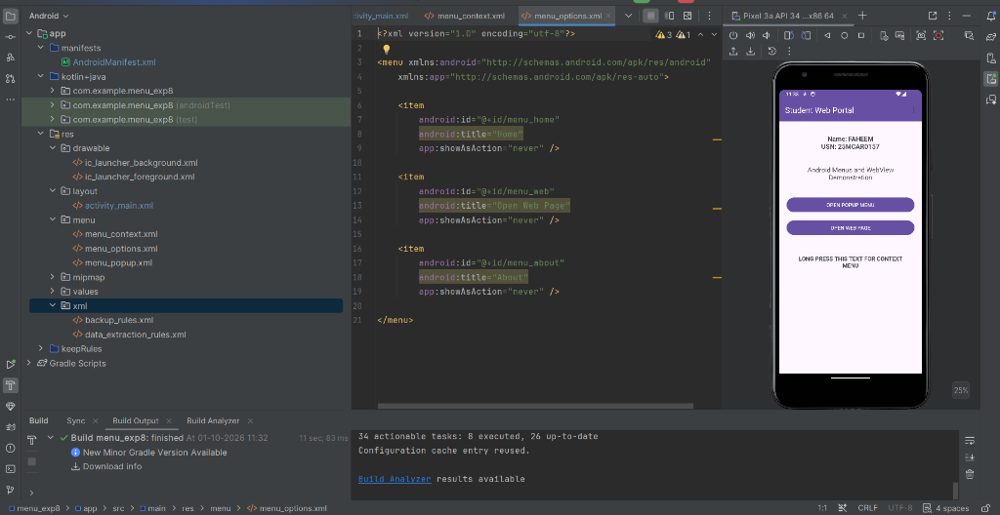
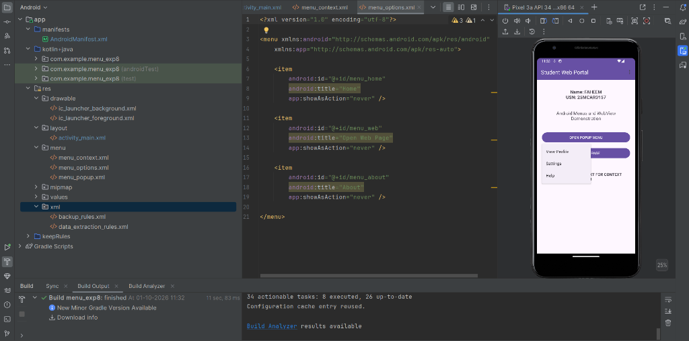
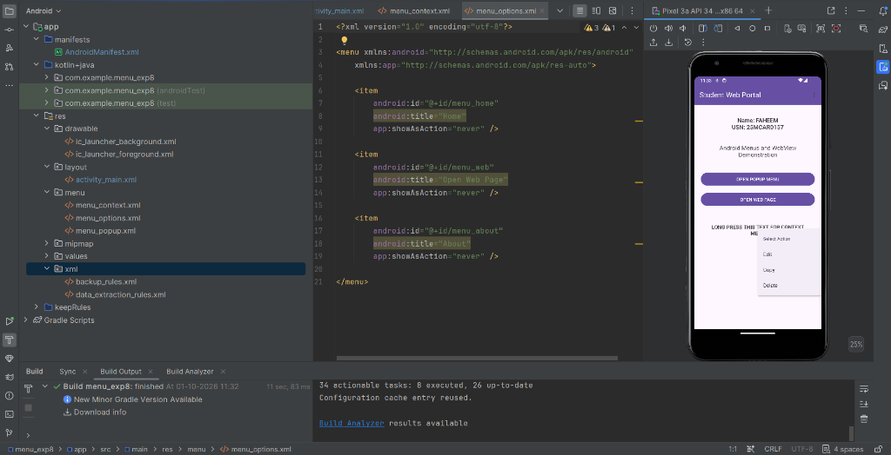
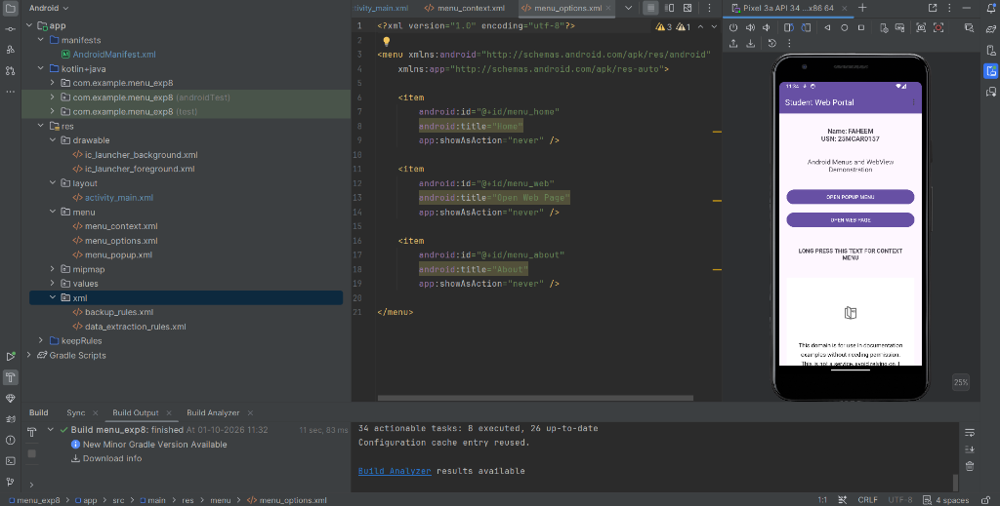

# Experiment 8 - Student Web Portal: Android Menus & WebView App

**Author & Sole Maintainer:** [faheem269056](https://github.com/faheem269056)

An Android application developed in **Kotlin** using **Android Studio** demonstrating the implementation of **three distinct types of Android Menus** (Options Menu, Context Menu, and Popup Menu) along with an interactive embedded **WebView** component integrated inside a Student Web Portal interface.

---

## 📸 Application Screenshots

| 1. Main Interface & Student Details | 2. Popup Menu View |
| :---: | :---: |
|  |  |
| *Student Web Portal showing Name: FAHEEM, USN: 25MCAR0157 & Action Bar Options Menu* | *Popup Menu anchored to button showing View Profile, Settings & Help* |

| 3. Floating Context Menu | 4. Embedded WebView Display |
| :---: | :---: |
|  |  |
| *Context Menu displaying "Select Action" (Edit, Copy, Delete) on long-pressing the text* | *Embedded WebView loading and rendering web content directly inside the application* |

---

## 📱 Features & Components

### 🎓 Student Profile Header
- **Student Name**: `FAHEEM`
- **USN**: `25MCAR0157`
- **Title**: Student Web Portal - Android Menus and WebView Demonstration

---

### 1. ⚙️ Options Menu (Action Bar / Toolbar)
- **Menu Resource**: `res/menu/menu_options.xml`
- **Implementation**:
  - Inflated in `onCreateOptionsMenu(menu: Menu)`.
  - Item selections handled via `onOptionsItemSelected(item: MenuItem)`.
- **Menu Items**:
  - 🏠 **Home**: Displays a Toast notification confirming Home selection.
  - 🌐 **Open Web Page**: Makes the WebView visible and loads the web address.
  - ℹ️ **About**: Displays project information via Toast (`Experiment 8 - Menus and WebView`).

---

### 2. 📋 Popup Menu (Button Anchored)
- **Menu Resource**: `res/menu/menu_popup.xml`
- **Implementation**:
  - Triggered on clicking the **`OPEN POPUP MENU`** button (`btnPopup`).
  - Anchored directly to the button view using `androidx.appcompat.widget.PopupMenu`.
- **Menu Items**:
  - 👤 **View Profile**: Displays Toast notification for Profile selection.
  - ⚙️ **Settings**: Displays Toast notification for Settings selection.
  - ❓ **Help**: Displays Toast notification for Help selection.

---

### 3. 📝 Floating Context Menu (Long-Press Action)
- **Menu Resource**: `res/menu/menu_context.xml`
- **Implementation**:
  - Registered to the TextView (`txtContext`) via `registerForContextMenu(contextText)`.
  - Inflated in `onCreateContextMenu(menu, v, menuInfo)` with header title *"Select Action"*.
  - Item clicks handled in `onContextItemSelected(item: MenuItem)`.
- **Menu Items**:
  - ✏️ **Edit**: Confirmed with Toast notification.
  - 📋 **Copy**: Confirmed with Toast notification.
  - 🗑️ **Delete**: Confirmed with Toast notification.

---

### 4. 🌐 Embedded WebView
- **Trigger**: Click event on **`OPEN WEB PAGE`** button (`btnWebView`) or selecting **Open Web Page** from the Toolbar Options Menu.
- **Configuration**:
  - JavaScript enabled (`webView.settings.javaScriptEnabled = true`).
  - DOM storage enabled (`webView.settings.domStorageEnabled = true`).
  - Integrated `WebViewClient` so links render directly inside the application instead of opening an external browser.

---

## 🛠️ Project Structure

```text
menu_exp8/
├── app/
│   ├── src/
│   │   ├── androidTest/
│   │   │   └── java/com/example/menu_exp8/
│   │   │       └── ExampleInstrumentedTest.kt
│   │   ├── main/
│   │   │   ├── java/com/example/menu_exp8/
│   │   │   │   └── MainActivity.kt
│   │   │   └── res/
│   │   │       ├── layout/
│   │   │       │   └── activity_main.xml
│   │   │       └── menu/
│   │   │           ├── menu_context.xml
│   │   │           ├── menu_options.xml
│   │   │           └── menu_popup.xml
│   │   └── test/
│   │       └── java/com/example/menu_exp8/
│   │           └── ExampleUnitTest.kt
│   └── build.gradle.kts
├── screenshots/
│   ├── 01_main_interface.png
│   ├── 02_popup_menu.png
│   ├── 03_context_menu.png
│   └── 04_webview.png
├── build.gradle.kts
├── settings.gradle.kts
└── README.md
```

---

## 🚀 How to Run the Project

1. Clone this branch:
   ```bash
   git clone -b exp8 https://github.com/faheem269056/Android-studio.git
   ```
2. Open the project folder in **Android Studio**.
3. Let Gradle complete the project build and dependency synchronization.
4. Launch an Android Virtual Device (AVD) or connect a physical device via USB debugging.
5. Click **Run 'app'** (`Shift + F10`) to deploy and test the app.

---

**Author**: [faheem269056](https://github.com/faheem269056)
