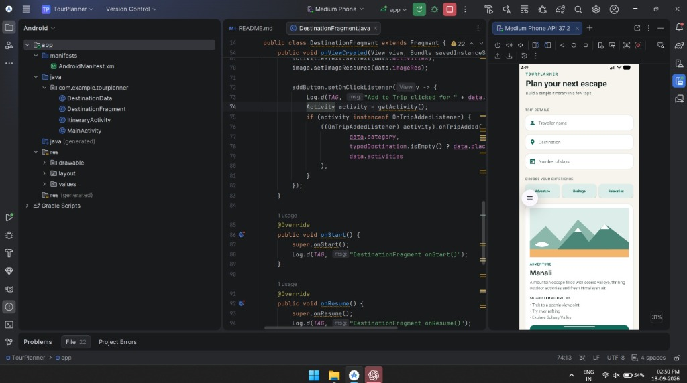
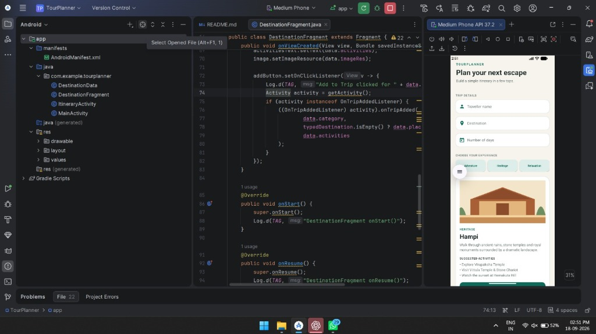
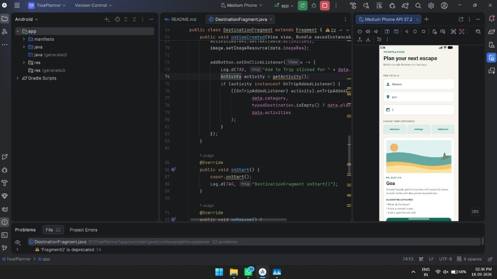

# TourPlanner ✈️📍

A modern, responsive Android Studio application built in Java for designing custom travel itineraries. **TourPlanner** allows users to input trip details, interactively explore curated experience categories (**Adventure**, **Heritage**, and **Relaxation**), view dynamic destination fragments with custom animations, receive system notifications, and view their final itinerary summary.

---

## 📱 Visual Showcase & UI Flow

| 🏔️ Adventure Category | 🏛️ Heritage Category | 🏖️ Relaxation Category |
| :---: | :---: | :---: |
|  |  |  |
| **Manali, Himachal Pradesh**<br>Scenic mountain escape with trekking, river rafting & Solang valley. | **Hampi, Karnataka**<br>Ancient ruins, Virupaksha Temple, Stone Chariot & Hemakuta Hill sunsets. | **Goa**<br>Golden beaches, coastal cafés, sunset cruises & peaceful coastal views. |

---

## ✨ Features & Architecture Highlights

- 📝 **Interactive Form Input**: Captures Traveller Name, Destination, and Number of Days with field validation.
- 🧩 **Dynamic Fragment Transactions**: Uses Android `FragmentManager` and `FragmentTransaction` with custom fade transitions (`fade_in`, `fade_out`) to load category cards without page reloads.
- 🔔 **Android 13+ Notification Support**: Registers a `NotificationChannel` (`tourplanner_channel`) and dynamically requests `POST_NOTIFICATIONS` runtime permissions on API 33+.
- 🔄 **Intent Navigation**: Passes structured trip metadata via Intent extras from `MainActivity` to `ItineraryActivity`.
- 📊 **Lifecycle Logging**: Features verbose Logcat debugging (`Log.d("TourPlanner", ...)`) tracking activity and fragment lifecycle methods (`onCreate`, `onStart`, `onResume`, `onPause`, `onStop`, `onDestroy`, `onDestroyView`).
- 🎨 **Custom XML Vector Drawables**: Clean, aesthetic card UI with rounded corners, custom inputs, and dynamic experience badges built with native Android XML drawables.

---

## 🛠️ Project Structure

```
TourPlanner/
├── app/
│   ├── src/main/
│   │   ├── java/com/example/tourplanner/
│   │   │   ├── MainActivity.java           # Main Activity handling form inputs & fragment transactions
│   │   │   ├── DestinationFragment.java    # Dynamic Fragment displaying curated place details
│   │   │   ├── ItineraryActivity.java      # Itinerary summary activity launched via Intent
│   │   │   └── DestinationData.java        # Data model & repository for trip categories
│   │   ├── res/
│   │   │   ├── drawable/                   # Vector graphics (bg_card, bg_input, category icons)
│   │   │   ├── layout/                     # activity_main.xml, fragment_destination.xml, activity_itinerary.xml
│   │   │   └── values/                     # colors.xml, styles.xml
│   │   └── AndroidManifest.xml
├── docs/screenshots/                       # UI screenshots for README
├── build.gradle                            # Project build script
├── settings.gradle                         # Gradle settings
└── README.md                               # Project documentation
```

---

## 🚀 How to Run in Android Studio

1. **Clone the Repository**:
   ```bash
   git clone https://github.com/faheem269056/Android-studio.git
   ```
2. **Open in Android Studio**:
   - Select **Open** and navigate to the cloned `TourPlanner` directory.
   - Allow Gradle sync to download dependencies and build the project.
3. **Run on Emulator / Physical Device**:
   - Create or select an Android Virtual Device (e.g. Medium Phone with API 33+).
   - Click **Run ▶** or press `Shift + F10`.

---

## 📋 Demo & Test Workflow

1. Enter **Traveller Name** (e.g., `faheem`), **Destination** (e.g., `Goa`), and **Number of Days** (e.g., `2`).
2. Switch between **Adventure**, **Heritage**, and **Relaxation** categories to see the `DestinationFragment` update smoothly.
3. Tap **ADD TO TRIP →**.
4. Observe the generated system notification: *"Destination added - Goa was added to your itinerary."*
5. View the finalized summary in `ItineraryActivity`.
6. Filter **Logcat** by tag `TourPlanner` to view full lifecycle callbacks.

---

## 🎓 Key Academic & Viva Takeaways

- **Fragment Lifecycle**: Reusable UI component instantiated dynamically using `DestinationFragment.newInstance(...)`.
- **Interface Communication**: Communicates between `DestinationFragment` and `MainActivity` via `OnTripAddedListener`.
- **Notification Manager**: Uses `NotificationManager.IMPORTANCE_DEFAULT` for Android Oreo (API 26) and above.
- **Explicit Intents**: Demonstrates bundle data transfer between activities.

---

**Author**: [faheem269056](https://github.com/faheem269056)
