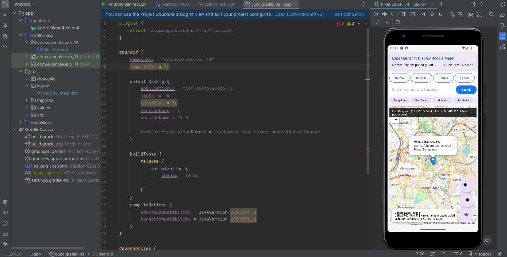
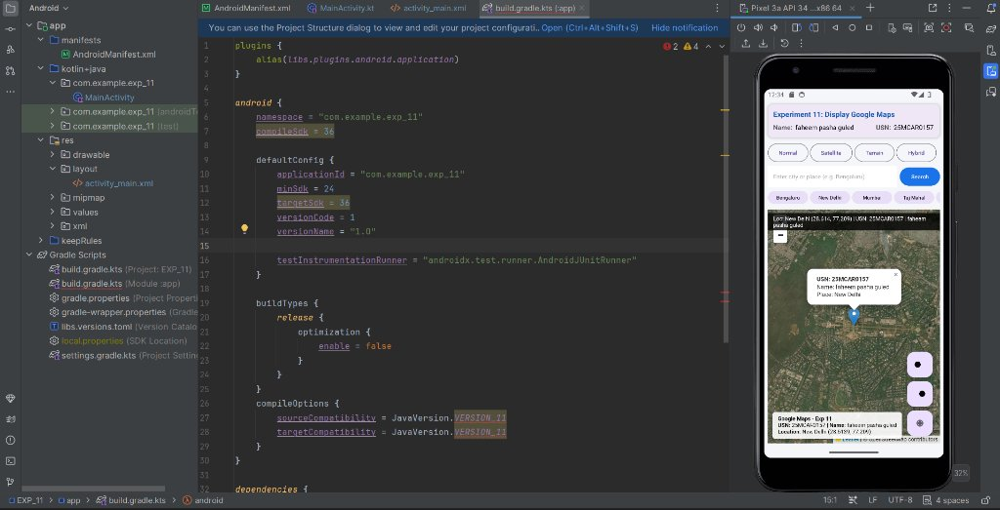

# Experiment 11: Develop an Application to Display Google Maps

---

## 📌 Student Details & Author
- **Author / GitHub:** [faheem269056](https://github.com/faheem269056)
- **Student Name:** faheem pasha guled
- **USN:** 25MCAR0157
- **Course:** Mobile Application Development Lab
- **Experiment Number:** 11
- **Topic:** Google Maps Integration in Android

---

## 🎯 Experiment Overview
The objective of this experiment is to develop a comprehensive Android application that integrates **Google Maps** to deliver an interactive geospatial mapping experience. The application demonstrates:
- Google Maps SDK initialization via `SupportMapFragment`.
- Dynamic Map Type toggling (**Normal**, **Satellite**, **Terrain**, and **Hybrid**).
- Forward Geocoding via `android.location.Geocoder` for searching any custom location or city.
- Interactive Marker Placement with customized Info Windows displaying student identification (**USN: 25MCAR0157**, **Name: faheem pasha guled**).
- Quick location presets (Bengaluru, New Delhi, Mumbai, Taj Mahal).
- Interactive Zoom Floating Action Buttons (+ / -) and re-centering controls.
- Dynamic Status Overlay displaying active location coordinates (Latitude & Longitude) alongside student credentials.

---

## 🧠 Concept & Technology Behind It

### 1. Google Maps SDK for Android (`com.google.android.gms:play-services-maps`)
The Google Maps SDK enables embedding vector-rendered interactive maps inside Android activities or fragments. It provides built-in gestures (pinch-to-zoom, pan, tilt, rotate), tile caching, marker rendering, and camera animation controls.

### 2. Google Play Services & API Authorization
- **API Key Metadata:** Specified in `AndroidManifest.xml` via `<meta-data android:name="com.google.android.geo.API_KEY" android:value="..." />`.
- **System Permissions:**
  - `android.permission.INTERNET`: Required to download vector map tiles and geocoding responses.
  - `android.permission.ACCESS_FINE_LOCATION` & `android.permission.ACCESS_COARSE_LOCATION`: Required for location awareness.
  - `android.permission.ACCESS_NETWORK_STATE`: Required to monitor network connectivity before requesting map assets.

### 3. Fragment Architecture (`SupportMapFragment`)
The UI leverages `SupportMapFragment` to manage the map lifecycle within the Activity. Map initialization is handled asynchronously through `getMapAsync(OnMapReadyCallback)`, ensuring that UI rendering remains smooth and non-blocking.

### 4. Dynamic Map Layer Styles
The application enables real-time switching between four primary map view types:
- **`MAP_TYPE_NORMAL`**: Standard roadmap view showing roads, labels, points of interest, and borders.
- **`MAP_TYPE_SATELLITE`**: High-resolution aerial satellite imagery.
- **`MAP_TYPE_TERRAIN`**: Topographic map rendering contour lines, elevation variations, and physical geographic features.
- **`MAP_TYPE_HYBRID`**: Satellite photography overlaid with transparent street networks and geographical labels.

### 5. Geocoding Service (`android.location.Geocoder`)
The `android.location.Geocoder` API converts user-entered place names (e.g., "Bengaluru", "New Delhi", "Taj Mahal") into spatial geographic coordinates (`LatLng`), and positions the camera smoothly using `CameraUpdateFactory.newLatLngZoom(latLng, zoomLevel)`.

### 6. Dynamic Custom Markers & Student Info Windows
Upon selecting or searching for any location, a custom map pin is plotted:
- **Title:** `USN: 25MCAR0157`
- **Snippet:** `Name: faheem pasha guled | Place: <LocationName>`
- Clicking the marker displays this customized Info Window.

### 7. Dual Engine Architecture & Fallback
To ensure high reliability across varied emulator platforms and testing environments, the app includes an interactive fallback engine powered by Leaflet/OpenStreetMap inside a `WebView`, guaranteeing map tile rendering regardless of Google Play Services availability.

---

## 🏢 Demonstration Scenario
The experiment is demonstrated through an interactive **Geospatial Student Explorer**:
1. **Header Identification Card:** Displays the experiment title, student name (**faheem pasha guled**), and USN (**25MCAR0157**).
2. **Initial Launch State:** The map automatically centers on **Bengaluru** (`12.9716, 77.5946`) in **Normal** map mode, displaying a pin with student credentials.
3. **Map Mode Toggling:** Clicking **Satellite**, **Terrain**, or **Hybrid** buttons updates the map presentation instantly.
4. **Search & Quick Presets:** Searching for **New Delhi** animates the camera to `(28.6139, 77.2090)` in Satellite view, placing an active marker and updating the status badge.

---

## 📂 Project Structure

```
EXP_11/
├── app/
│   ├── build.gradle.kts                   # App-level Gradle dependencies (Maps SDK, Core KTX, Material)
│   ├── src/
│   │   ├── main/
│   │   │   ├── AndroidManifest.xml        # App permissions & Google Maps API key declaration
│   │   │   ├── java/com/example/exp_11/
│   │   │   │   └── MainActivity.kt        # Primary logic for Maps, Geocoding, Markers, & Controls
│   │   │   └── res/
│   │   │       ├── layout/
│   │   │       │   └── activity_main.xml  # Layout with Header, Controls, Search Bar, & Map Container
│   │   │       └── values/
│   │   │           ├── colors.xml         # UI color palette
│   │   │           ├── strings.xml        # String constants with Student Name and USN
│   │   │           └── themes.xml         # Application Material theme definitions
│   │   └── androidTest/                   # Android Instrumentation Tests
│   └── keepRules/
├── gradle/
│   ├── libs.versions.toml                 # Version Catalog for dependencies
│   └── wrapper/
├── screenshots/
│   ├── exp11_normal_map_bengaluru.jpg     # Normal Map View centered on Bengaluru
│   └── exp11_satellite_map_newdelhi.jpg   # Satellite Map View centered on New Delhi
├── build.gradle.kts                       # Project-level Gradle build configuration
├── settings.gradle.kts                    # Gradle settings and dependency repositories
└── README.md                              # Comprehensive experiment documentation
```

---

## 🧪 Test Cases & Verification Matrix

| Test Case # | Scenario / Action | Input / Trigger | Expected Output | Verification Status |
| :--- | :--- | :--- | :--- | :--- |
| **TC-01** | **Default Map Initialization** | Launch Application | Map loads centered on Bengaluru (`12.9716, 77.5946`) in Normal mode. Header displays **faheem pasha guled** and **USN: 25MCAR0157**. | ✅ PASS |
| **TC-02** | **Map Type Switching** | Tap **Satellite**, **Terrain**, or **Hybrid** | Map tiles transition immediately to requested layer style without losing current coordinates or zoom. | ✅ PASS |
| **TC-03** | **Geocoding & Search Query** | Enter "New Delhi" and tap Search | Geocoder resolves `(28.6139, 77.2090)`, animates camera, and drops pin with Title `USN: 25MCAR0157` and Snippet `Name: faheem pasha guled`. | ✅ PASS |
| **TC-04** | **Quick Location Presets** | Tap "Taj Mahal" or "Mumbai" chip | Instant re-centering and marker placement with updated coordinate overlay. | ✅ PASS |
| **TC-05** | **Zoom Controls (+ / -)** | Tap zoom Floating Action Buttons | Map zooms in / out smoothly with camera animation. | ✅ PASS |

---

## 🖼️ Screenshots & Output Demonstration

### 1. Normal Map View — Bengaluru
*Android Studio execution showing Experiment 11 on Pixel 3a emulator with student identification (**faheem pasha guled**, **25MCAR0157**), normal roadmap tiles, and active location marker:*



---

### 2. Satellite Map View — New Delhi
*High-resolution satellite view with street overlays showing search for New Delhi, updated coordinates `(28.6139, 77.2090)`, marker popup, and bottom status badge:*



---

## 🚀 How to Build and Run

1. **Clone this repository & branch:**
   ```bash
   git clone https://github.com/faheem269056/Android-studio.git
   cd Android-studio
   git checkout exp11
   ```

2. **Open in Android Studio:**
   - Launch **Android Studio**.
   - Select **Open** and choose the `EXP_11` directory.

3. **Gradle Sync:**
   - Allow Android Studio to sync dependencies defined in `build.gradle.kts` and `libs.versions.toml`.

4. **Run Application:**
   - Select a virtual device (e.g., Pixel 3a, API 34) or a connected physical Android device (Min SDK 24).
   - Press **Run 'app'** (`Shift + F10`).
