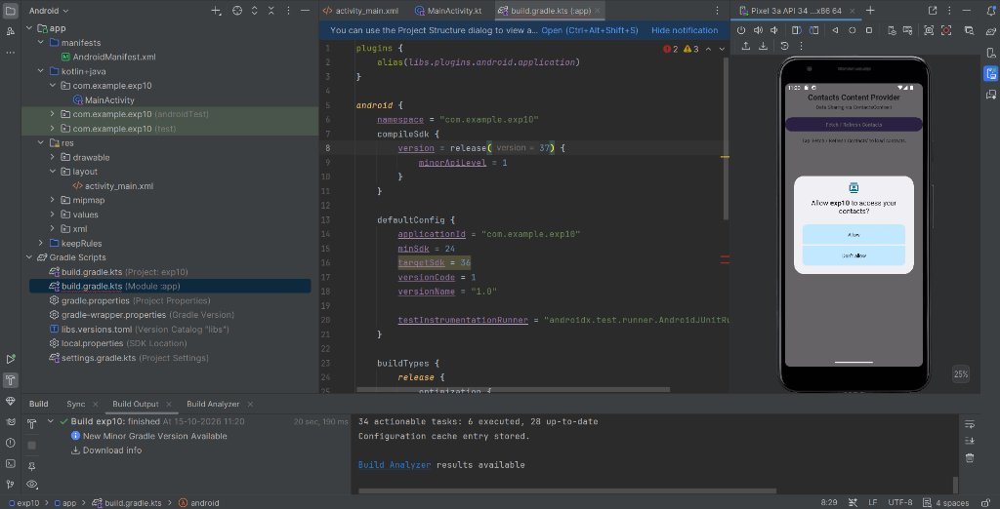
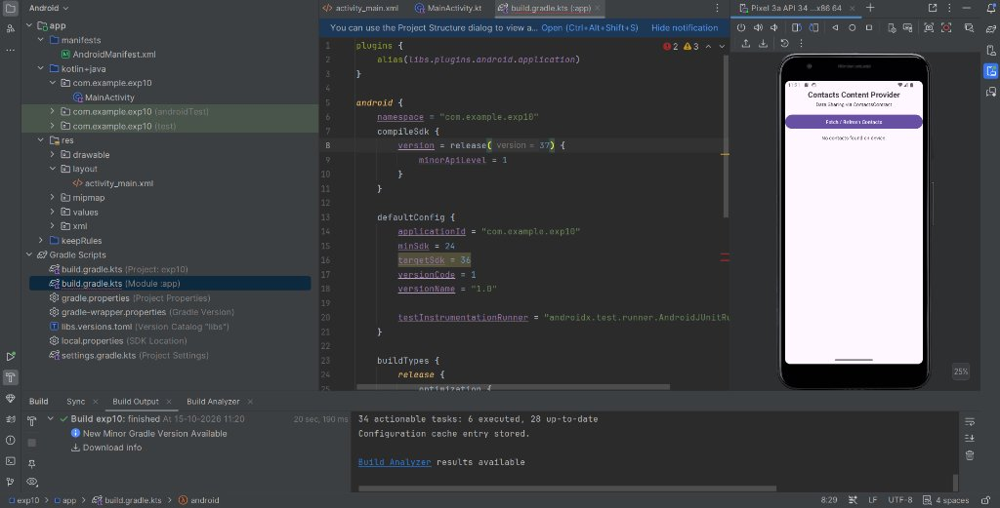

# Experiment 10: Contacts Content Provider

An Android application demonstrating inter-app data sharing using **Android Content Providers** and **Content Resolvers**. The app requests runtime contact access and queries the system's `ContactsContract` provider to retrieve and display contact details in a structured list.

---

## 📱 Features

- **Runtime Permission Handling**: Safe request for `android.permission.READ_CONTACTS` using AndroidX `ActivityResultContracts.RequestPermission()`.
- **Content Provider Integration**: Queries `ContactsContract.CommonDataKinds.Phone.CONTENT_URI` via Android `ContentResolver`.
- **Data Projection & Querying**: Extracts display names and phone numbers sorted alphabetically (`DISPLAY_NAME ASC`).
- **Dynamic UI & List Binding**: Binds contact data to a `ListView` using an `ArrayAdapter`.
- **Status & State Feedback**:
  - Initial idle prompt
  - Permission granted / denied notification
  - Real-time count of loaded contacts
  - *"No contacts found on device"* empty state

---

## 📸 Screenshots

| 1. Permission Request Dialog | 2. Contacts Display / Empty State |
| :---: | :---: |
|  |  |

---

## 🛠️ Tech Stack & Requirements

- **Language**: Kotlin
- **Minimum SDK**: API 24 (Android 7.0)
- **Target SDK**: API 36
- **Compile SDK**: API 37
- **Build System**: Gradle Kotlin DSL (`build.gradle.kts`)
- **IDE**: Android Studio Ladybug / Koala or newer

---

## 🚀 How to Run the Project

1. **Clone the repository** and checkout the `exp10` branch:
   ```bash
   git clone -b exp10 https://github.com/faheem269056/Android-studio.git
   ```
2. Open the project folder in **Android Studio**.
3. Wait for Gradle to sync dependencies and build the project.
4. Run the app on an Android Emulator or connected physical device (Android 7.0+).
5. Tap **"Fetch / Refresh Contacts"** and grant contact permissions when prompted.

---

## 👤 Author

- **[faheem269056](https://github.com/faheem269056)**
