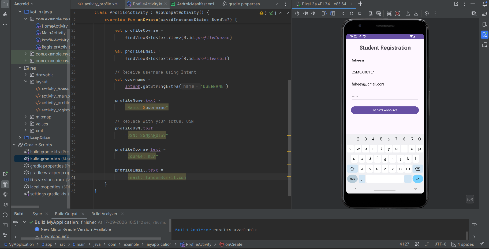
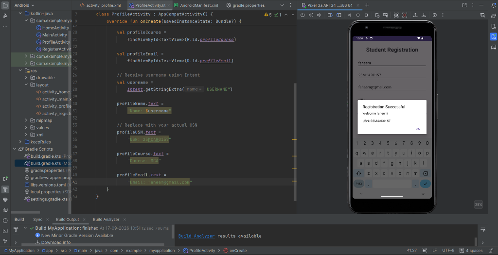
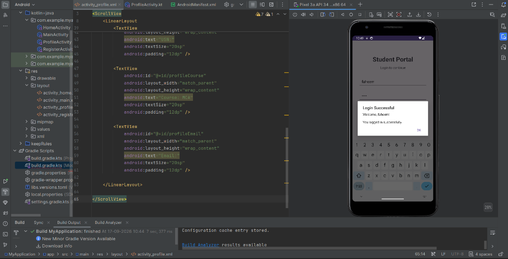
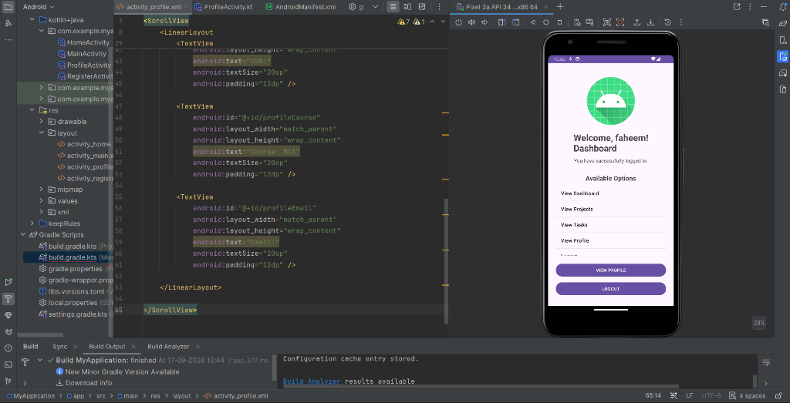
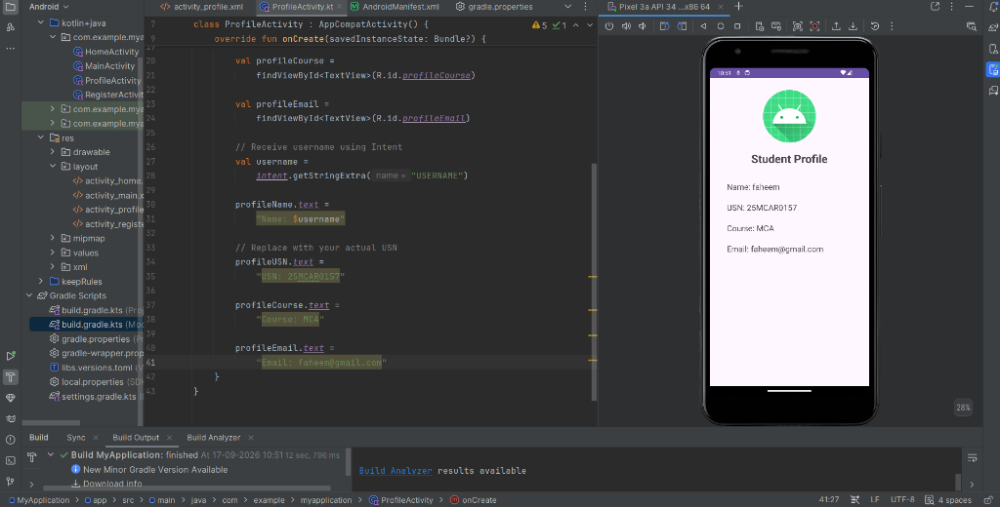

# Student Portal Application (Experiment 7) 🎓📱

An Android application developed using **Kotlin** and **Android Studio**, demonstrating user authentication, explicit activity navigation using Android `Intent`s with data transfer, dynamic `ListView` menus, `AlertDialog` notifications, and student profile management.

---

## 👤 Author & Owner
- **[faheem269056](https://github.com/faheem269056)** - Sole Author & Project Owner

---

## 📱 Visual Showcase & Application Workflow

### 1. Student Registration & Validation
| 📝 Registration Form | ✅ Registration Success Dialog |
| :---: | :---: |
|  |  |
| *Student Registration interface with input fields: Name, USN, Email, and Password* | *Interactive AlertDialog confirming account creation with student credentials* |

---

### 2. Student Login & Authentication
| 🔐 Student Portal Login & Success Confirmation |
| :---: |
|  |
| *Login interface verifying credentials and displaying welcome dialog before dashboard transition* |

---

### 3. Student Dashboard & Navigation
| 📊 Student Dashboard Menu |
| :---: |
|  |
| *Personalized welcome dashboard with interactive list menu (Projects, Tasks, Profile) and action buttons* |

---

### 4. Student Profile View
| 👨‍🎓 Student Profile Screen |
| :---: |
|  |
| *Student profile view presenting verified academic details: Name, USN, Course, and Email* |

---

## ✨ Features & Architecture Highlights

- 📝 **Student Registration (`RegisterActivity`)**:
  - Captures student profile details: Name, USN, Email address, and Password.
  - Implements client-side input validation checking for empty fields.
  - Displays an `AlertDialog` confirming successful registration with the student's name and USN.

- 🔑 **Student Authentication (`MainActivity`)**:
  - Secure login interface requiring Username and Password.
  - Validates credentials and shows feedback via Toast and `AlertDialog`.
  - Seamlessly passes logged-in student credentials to subsequent activities using an Explicit `Intent` payload (`intent.putExtra("USERNAME", username)`).

- 🧭 **Interactive Dashboard (`HomeActivity`)**:
  - Features personalized welcome banner dynamically rendered for the authenticated student.
  - Dynamic `ListView` populated via `ArrayAdapter` featuring navigation options:
    - View Dashboard
    - View Projects
    - View Tasks
    - View Profile
  - Quick action buttons for viewing Profile directly or logging out.

- 📋 **Student Profile Management (`ProfileActivity`)**:
  - Receives Intent extras and renders full student academic credentials.
  - Verified student record:
    - **Name**: `faheem`
    - **USN**: `25MCAR0157`
    - **Course**: `MCA`
    - **Email**: `faheem@gmail.com`

---

## 🛠️ Project Structure

```
MyApplication/
├── app/
│   ├── src/main/
│   │   ├── java/com/example/myapplication/
│   │   │   ├── MainActivity.kt        # Login screen & intent dispatcher
│   │   │   ├── RegisterActivity.kt    # Account creation & registration dialog
│   │   │   ├── HomeActivity.kt        # Student dashboard & ListView menu
│   │   │   └── ProfileActivity.kt     # Profile details rendering
│   │   ├── res/
│   │   │   ├── layout/
│   │   │   │   ├── activity_main.xml
│   │   │   │   ├── activity_register.xml
│   │   │   │   ├── activity_home.xml
│   │   │   │   └── activity_profile.xml
│   │   │   ├── values/
│   │   │   │   ├── colors.xml
│   │   │   │   ├── strings.xml
│   │   │   │   └── themes.xml
│   │   └── AndroidManifest.xml
├── screenshots/                       # Application execution screenshots
│   ├── dashboard.png
│   ├── login_success.png
│   ├── profile.png
│   ├── registration.png
│   └── registration_success.png
├── build.gradle.kts                   # Project-level build configuration
├── settings.gradle.kts                # Gradle settings
└── README.md                          # Experiment documentation
```

---

## 💻 Technology Stack & Tools

- **Programming Language**: Kotlin
- **Development Environment**: Android Studio
- **UI Components**: XML Layouts, ScrollView, LinearLayout, EditText, Button, TextView, ListView
- **Android APIs & Architecture**: `AppCompatActivity`, `Intent` (Explicit Navigation & Extras Transfer), `AlertDialog.Builder`, `ArrayAdapter`
- **Target SDK**: Android API 34 (Android 14)

---

## 🚀 How to Run the Project

1. **Clone the Repository**:
   ```bash
   git clone https://github.com/faheem269056/Android-studio.git
   cd Android-studio
   git checkout exp7
   ```

2. **Open in Android Studio**:
   - Launch Android Studio and click **Open**.
   - Select the cloned project folder and allow Gradle sync to complete.

3. **Run on Emulator / Physical Device**:
   - Select an emulator (e.g. Pixel 3a API 34) or connect a physical Android device with USB debugging enabled.
   - Click **Run ▶** (or press `Shift + F10`).

---

## 📄 License & Ownership
Developed and maintained solely by **[faheem269056](https://github.com/faheem269056)**. All rights reserved.
